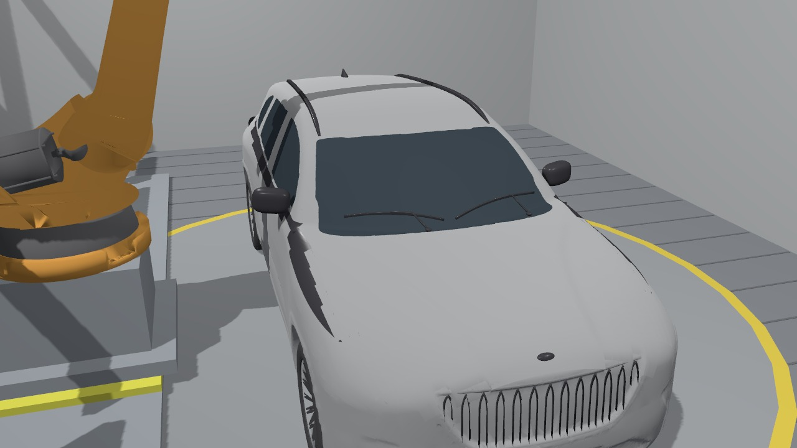
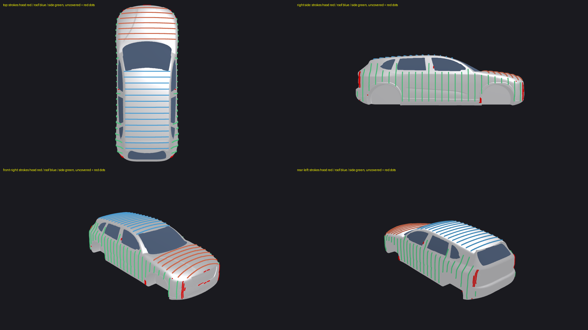
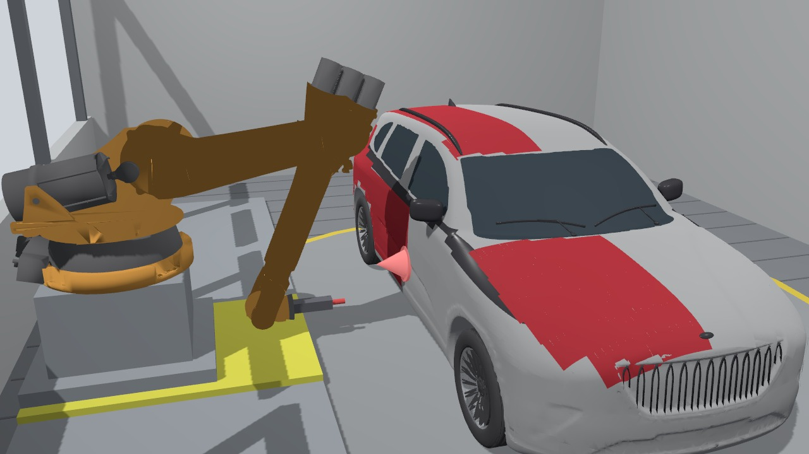

# Robotic Car Painting Cell - ROS 2 / MoveIt 2 / Gazebo Harmonic

| | |
|---|---|
| **Name** | Lassaad Mahmoudi |
| **Software used** | ROS 2 Jazzy, MoveIt 2 (OMPL, KDL, FCL), Gazebo Harmonic (gz_ros2_control), Python 3 (NumPy, trimesh) on Ubuntu 24.04 (WSL 2) |
| **Robot selected** | KUKA KR 210 L150 (ROS-Industrial model), on a rail + cross slide, with a paint gun end effector |

A KUKA KR 210 L150 paints a Togg T10X body (scaled to the 4,800 x 1,900 x 1,600 mm of the brief) standing on a turntable in a
Gazebo paint booth. The spray paths are cast onto the body mesh, every motion is planned with MoveIt 2 against a full collision
scene, the recorded plan is verified independently, and Gazebo executes it through ros2_control.

**Demo video and report:** see [`docs/Technical_Report.pdf`](docs/Technical_Report.pdf) and the Drive folder: https://drive.google.com/drive/folders/1qovta20oiRVogkL21aGCfzKGMFycxMRL?usp=drive_link

## Results

| | |
|---|---|
| Strokes planned | **94 / 94** (11 needed a fallback, 0 failed), planning time 138 s |
| Paint coverage | hood 99.3 %, roof 100 %, side panels 98.4 % (sill to window line) |
| Collision re-check of all recorded motion | **3,137 states, 0 collisions** |
| Turntable rotation, 5 degree steps | 36 / 36 positions collision free |
| Nozzle tracking error | mean 0.41 mm, max 2.8 mm |
| Cycle time (simulated, whole car) | 12.7 min (4.6 min spraying) |
| Negative test (nozzle 4 cm inside the hood) | rejected: MoveIt stops at 70 % with a gun-car contact |





## What is in the cell

* 11 x 8 m booth, car on a flush turntable (indexes 180 degrees so both sides are reachable)
* KUKA KR 210 L150 on an 8 m rail with a 0.9 m **cross slide** (8 axes in total). A reach study showed that no fixed base position
  can paint both the side panels (base about 3.0 m from the car axis) and the roof/hood (about 2.2 m), hence the cross slide
* paint gun, 250 mm spray fan, nozzle tip = TCP
* the car: a Togg T10X mesh prepared by `tools/prep_car.py` - light bar, livery and number plates removed, windows found by
  ray casting, oriented and scaled to the brief; the KUKA URDF/meshes come from ROS-Industrial (Apache-2.0)

## How it works

1. `tools/prep_car.py` prepares the car meshes; `tools/gen_paths.py` ray-casts the body panels and writes the 94
   surface-following strokes (arc-length spacing, 30 % overlap, gun along the surface normal at 250 mm).
2. `plan_paint` (ROS node) plans each stroke with MoveIt: rail/cross-slide station, IK + OMPL pre-pose, Cartesian approach,
   collision-checked painting pass, retreat, with fallbacks (other stations, 12 degree gun tilt). The turntable rotation is swept
   in 5 degree steps against the whole scene.
3. `tools/verify_plan.py` re-checks every recorded trajectory against the collision scene and measures nozzle tracking and speed;
   `tools/collision_demo.py` runs the negative test.
4. `tools/make_gz_world.py` builds the Gazebo booth (car visuals, paint strips, spray cone, camera); `gz_cell.launch.py` starts
   Gazebo with the robot under gz_ros2_control; `gz_play` sends the plan to the joint_trajectory_controller, steps the world
   frame by frame and films it; `tools/make_video_gz.py` assembles the captioned demo video.

## Reproduce (Ubuntu 24.04 / WSL 2)

```bash
sudo apt install ros-jazzy-desktop ros-jazzy-moveit ros-jazzy-xacro ros-jazzy-ros-gz ros-jazzy-gz-ros2-control \
                 ros-jazzy-ros2-controllers python3-colcon-common-extensions
pip install trimesh rtree scipy fast-simplification pyrender            # car preparation, paths, figures
mkdir -p ~/ws/src && cp -r src/* ~/ws/src/ && cd ~/ws && source /opt/ros/jazzy/setup.bash && colcon build --symlink-install
source install/setup.bash

python3 tools/prep_car.py <togg.stl>     # car meshes (needs the downloaded model, binary STL)
python3 tools/gen_paths.py               # 94 strokes -> results/paths.json (copy to src/painting_cell/paths/)

ros2 launch painting_cell cell.launch.py mode:=plan rviz:=false &     # MoveIt + robot model
ros2 run painting_cell plan_paint --out plan.json                     # plan the whole job (about 2-3 minutes)
python3 tools/verify_plan.py plan.json verify.json                    # independent verification

python3 tools/make_gz_world.py                                        # Gazebo world (rebuild the workspace after it)
ros2 launch painting_cell gz_cell.launch.py &                         # Gazebo + ros2_control (add gui:=true for the GUI)
ros2 run painting_cell gz_play --plan plan.json --out ~/gz_render     # execute + film
python3 tools/make_video_gz.py                                        # -> video/demo.mp4
```

`results/` holds the data produced by these steps (`plan.json`, `verify.json`, `paths.json`, `collision_demo.json`,
`gz_summary.json`, `planner_log.txt`); `results/v1_box_car/` keeps the first version (procedural box car).

## Known limitations

* Front/rear fascias, window pillars and the sill under-curve are not painted (they need dedicated short programs).
* Paint is shown by recolouring strips over the body; no film-thickness or overspray model.
* The PC renders in software, so Gazebo is stepped one frame (0.5 s simulated, 10 physics steps of 0.05 s) at a time and the video is a time-lapse; the
  motion is the MoveIt plan replayed by ros2_control, not a dynamics study.
* KDL IK is a local solver (11 strokes needed a fallback); `pick_ik` or analytic IK would reduce that.

## Credits and licence

Original code: Apache-2.0 (see `LICENSE`). KUKA KR 210 model: ROS-Industrial `kuka_experimental` (Apache-2.0, see
`src/kuka_kr210_support/LICENSE`). Togg T10X mesh: third-party download, modified (light bar, livery, plates removed; scaled)
for this simulation.

**The car meshes are not in this repository**, because they are derived from a third-party model. They are
`src/painting_cell/meshes/car_*.stl`, `src/painting_cell/gz/meshes/car_*.obj` and the paint strips
`src/painting_cell/gz/paint/*.obj`. Regenerate them from the downloaded model with `tools/prep_car.py` and then
`tools/make_gz_world.py`. They are left out of `Simulation_Files/` in the Drive folder for the same reason.
